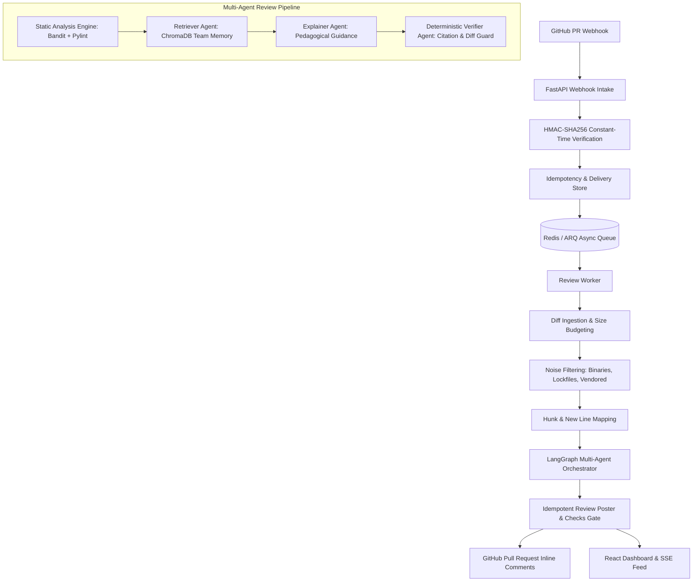
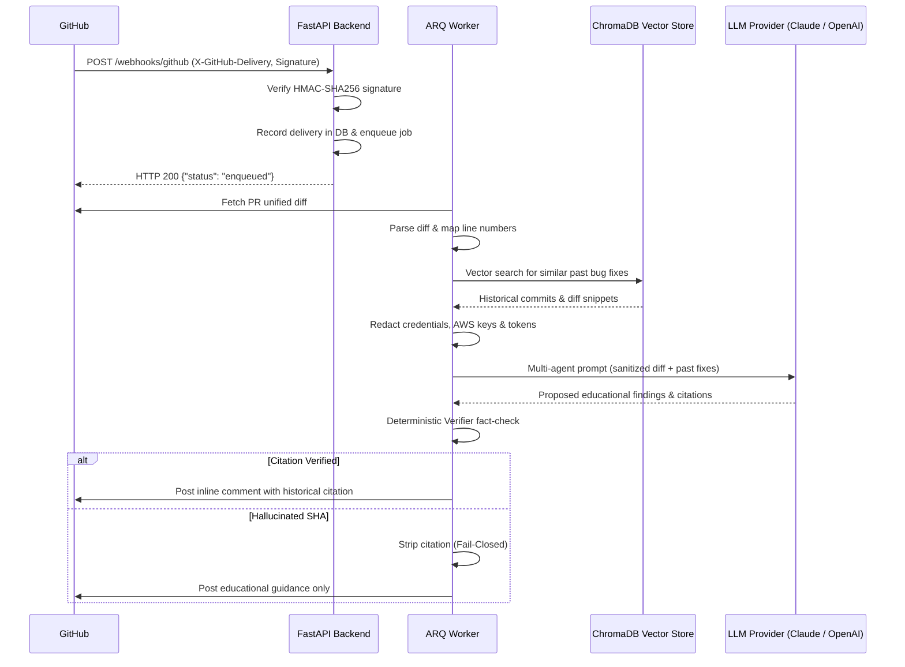

# MentorLens Architecture & System Design

MentorLens is an agentic AI code-review mentor that turns GitHub Pull Request reviews into high-retention institutional learning opportunities by grounding review comments in verified past bug-fix commits from your own team's repository history.

---

## 1. End-to-End Pipeline Architecture

---

## 2. Core Components

### 1. Ingestion & Security Intake (`app/github/webhook.py`)
- **Signature Verification:** Constant-time `hmac.compare_digest` with HMAC-SHA256 before parsing payload bytes.
- **Idempotency:** Unique `X-GitHub-Delivery` delivery tracking guarantees at-most-once processing.
- **Payload Capping:** 5 MB payload limit prevents memory exhaustion attacks.
- **Mid-run Synchronize Cancellation:** When a new commit is pushed mid-review, previous review runs for the older commit are automatically cancelled.

### 2. Diff Processing & Filtering (`app/github/diff.py`, `app/github/filter.py`)
- **Binary & Lockfile Exclusion:** Binary files, lockfiles (`package-lock.json`, `poetry.lock`), and vendored directories (`dist/`, `node_modules/`, `build/`) are skipped automatically.
- **Size Budgeting:** Caps PR diffs to 40 files and 1500 lines to prevent runaway LLM costs; prioritizes security-sensitive files (auth, tokens, queries) first.
- **Line Mapping:** Bi-directional map correlating new file line numbers with GitHub unified diff hunk positions.

### 3. Multi-Agent Pipeline (`app/agents/`)
- **Static Analysis Runner (`app/analysis/runner.py`):** Sandboxed Bandit (security AST) and Pylint (code quality) runners. Syntax errors are caught early to prevent execution failures.
- **Retriever Agent (`app/agents/retriever.py`):** Queries ChromaDB team memory vector store for past bug-fix commits touching similar code.
- **Explainer Agent (`app/agents/explainer.py`):** Structures comments using the Clean Neo-Brutalist educational template:
  1. Title + Severity
  2. Why this is risky
  3. How to fix (with suggested code diff)
  4. From your team's history (cited commit + author context)
- **Verifier Agent (`app/agents/verifier.py`):** Deterministic fact-checking gate applying 4 rules:
  1. Cited commit SHA exists in git history.
  2. Cited diff touches code with similarity ≥ 0.40.
  3. Claim matches commit message.
  4. Reported line number exists in the PR diff.
  - **Verdict:** If rules 1–3 fail, the citation is stripped and the pedagogical guidance is kept. If rule 4 fails, the finding is shifted to the PR-level summary.

### 4. GitHub Review Poster & Checks Gate (`app/github/poster.py`)
- **Idempotent Updates:** Unique HTML comment markers (`<!-- mentorlens:finding:{file}:{line}:{category} -->`) enable updating existing review comments in place on commit re-runs, eliminating comment spam.
- **Checks API Gate:** Emits GitHub Check Runs (`action_required` on critical findings, `success` otherwise).

### 5. Clean Neo-Brutalist Dashboard (`frontend/`)
- Built with React 18, Vite, TypeScript, and Tailwind CSS.
- Strictly adheres to the Neo-Brutalist design language: Paper `#F4EFE6`, hard 4px offset shadow `#111`, thick 2-3px borders, floating glass top bar, Bricolage Grotesque + IBM Plex Sans + JetBrains Mono typography.
- 16 screens covering onboarding, PR review details, run traces, memory explorer, developer learning curves, team analytics, rules & gate settings, integration health, demo mode, and mobile responsive views.

---

## 3. Data Flow & Security Model

---

## 4. Privacy & Security Safeguards
1. **Secrets Redaction:** Diff content is scanned against regex patterns (AWS keys, GitHub tokens, Anthropic/OpenAI keys, private keys, passwords) and sanitized before any vector storage or LLM transmission.
2. **Untrusted Input Encapsulation:** PR code is encapsulated within `<UNTRUSTED_PR_CONTENT>` delimiters in prompts, neutralizing prompt injection attacks.
3. **ORM-Only Queries:** All database queries are executed via SQLAlchemy async ORM with parameterized parameters; raw string SQL queries are forbidden.
4. **Least-Privilege GitHub Permissions:** Pull requests (read & write), Contents (read), Metadata (read), Checks (write).
5. **Cascading Data Deletion:** Admin action cascades deletion across PostgreSQL / SQLite tables and purges corresponding ChromaDB vector collections, recording an immutable `AuditLog` entry.
