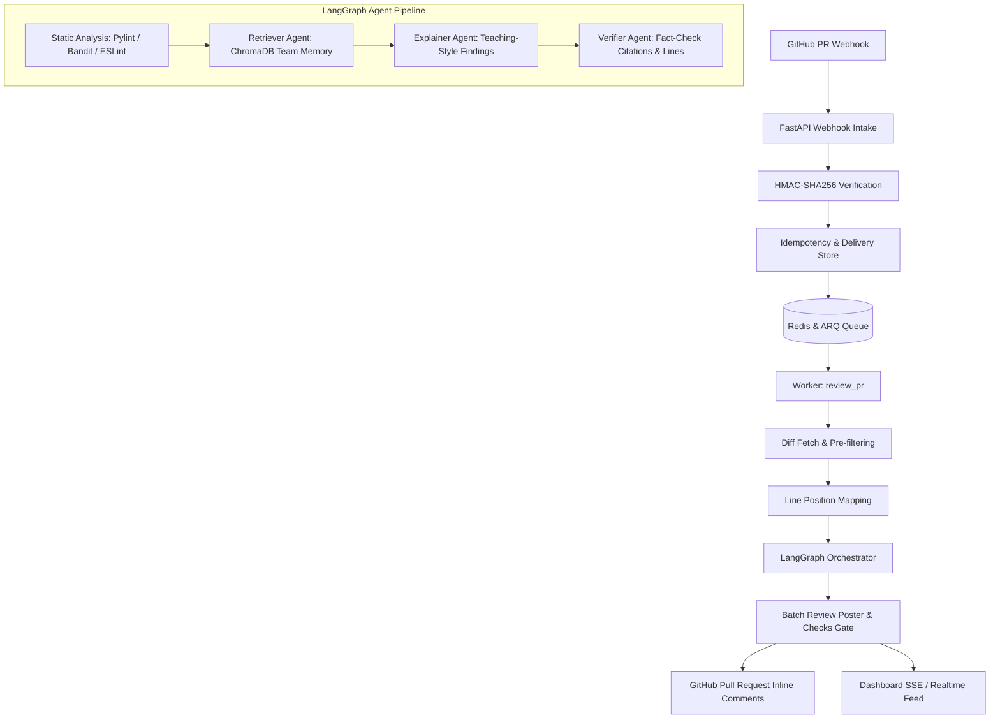

# MentorLens Architecture

MentorLens is an agentic AI code-review mentor designed to turn PR reviews into high-retention institutional learning opportunities.

## Core Tenets
1. **Never Post an Unverified Citation**: Every cited SHA and historical diff is fact-checked against the repository and verified with semantic matching.
2. **Teaching First**: Findings follow the structured learning framework:
   - What the issue is
   - Why it is risky
   - How to fix it (with actionable code suggestion)
   - Real institutional memory context from past team commits
3. **Fail-Closed on Unverified Citations, Fail-Open on Guidance**: If a citation fails verification, the citation is stripped while keeping the educational guidance.
